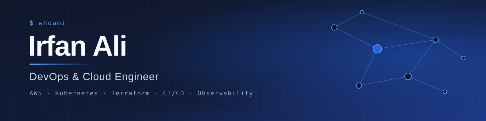

&nbsp;&nbsp;
&nbsp;&nbsp;

## 🚀 About Me

Hi, I'm **Irfan** — a self-directed **DevOps and Cloud Engineer** and final-year CS student, building hands-on, production-style infrastructure projects. Open to junior DevOps, Cloud, and Platform Engineering roles.

- ☁️ **Cloud:** AWS: EC2, VPC, S3, IAM, EKS
- 🛠 **IaC & CI/CD:** Terraform, Ansible, GitHub Actions, ArgoCD
- 📦 **Containers:** Docker, Kubernetes, Helm
- 📊 **Observability:** Prometheus, Grafana, Loki
- 🔐 **DevSecOps:** Trivy, Snyk, OPA/Gatekeeper

> "Automate the boring parts, monitor everything else."

---

## 🧰 Tech Stack

---

## 📊 GitHub Stats

---

## 🧭 My Approach

1. 🔁 Automate what repeats
2. 🧩 Break systems down before scaling them
3. 📈 Measure before optimizing
4. 💬 Document and share what I learn
---

## 🌱 Currently

- 🤖 Using AI tools to speed up troubleshooting, automation, and infrastructure decisions
- 🌐 Going deeper on cloud networking: VPCs, CIDR/subnetting, ALB/NLB, DNS
- 💰 Building AWS cost optimization (FinOps) projects

---

### ⚡ Build. Automate. Deploy. Observe. Repeat.

